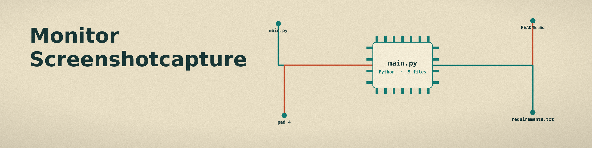

# monitor-screenshotcapture
Captures screenshots of the full screen (the whole desktop) at set intervals and saves them for later analysis. Every saved image holds the whole desktop, not only the active window. A bounded run (with `-d`) that saves no screenshots exits with code 1; in indefinite mode a running saved and failed count is logged on every cycle. The one real dependency is Pillow, named in requirements.txt. - Focused on System monitoring and alerts

## Install
`git clone https://github.com/ShadowGuardAI/monitor-screenshotcapture`

## Usage
`./monitor-screenshotcapture [params]`

## Parameters
- `-h`: Show help message and exit
- `-i`: No description provided
- `-o`: No description provided
- `-n`: No description provided
- `-q`: No description provided
- `-f`: No description provided
- `-d`: No description provided

## License
Copyright (c) ShadowGuardAI
